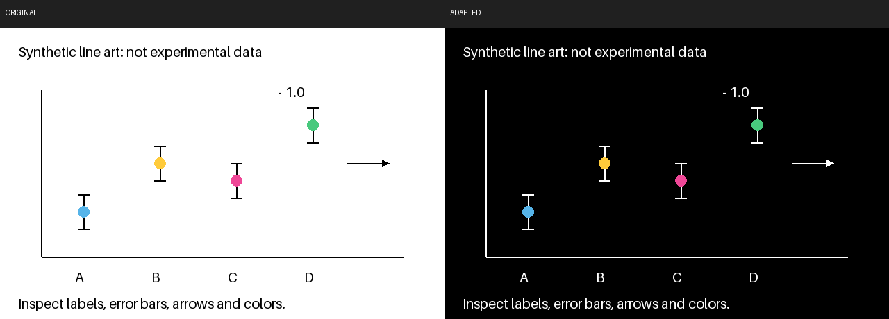

# Black Background Figures

Repository: [LinfengHarryHu/black-background-figures](https://github.com/LinfengHarryHu/black-background-figures).

**Deterministic color adaptation for scientific slides, with an auditable source-to-output record.** This is a small Python tool and reusable AI-assistant skill. It does not use a generative image model.

An AI assistant can help select a workflow and parameters, or write the code. The image-processing step executes explicit pixel rules. For selected input pixels at the same coordinates, neutral inversion computes:

`(R, G, B, A) → (255 − R, 255 − G, 255 − B, A)`

Unselected and protected pixels are unchanged. Dimensions and pixel positions are unchanged. The default selects exactly neutral pixels; a specified tolerance can include near-neutral colors. Optional exact categorical remapping is explicit and rejects observed color collisions.

**These guarantees do not mean every detail remains equally visible.** Contrast between regions and shading can change. Before/after review remains necessary; retain a white panel whenever a dark adaptation obscures evidence.



The example is an original, hand-coded test drawing, not a published figure, experimental image or AI-generated illustration.

## Install and use

Python 3.9 or newer; NumPy and Pillow. No model, API key or network access is needed to process an image.

```bash
python -m venv .venv
source .venv/bin/activate
python -m pip install -r requirements.txt

python scripts/pixel_theme.py examples/synthetic_original.png my_dark.png --kind line-art
python scripts/verify_theme.py my_dark.json --source examples/synthetic_original.png
python -m unittest discover -s tests -v
```

Use a new output name for each variant. Commands refuse to overwrite either the output or its audit sidecars.

The helper accepts 8-bit L/LA/RGB/RGBA PNG. It refuses unsupported precision, indexed palettes, animation and non-identity EXIF orientation. Preserve raw scientific files; exporting a presentation PNG is a separate, documented preprocessing operation. Color profiles and supported color-metadata chunks are retained. A grayscale ICC profile requires a separate RGB export before inversion. Output is losslessly encoded, but inverted pixels are deliberately different from the source; arbitrary source-file metadata is not promised to be preserved.

For a measurement image that should stay unchanged:

```bash
python scripts/pixel_theme.py original_gel.png gel_copy.png --kind measurement --mode keep
```

This copies the source file byte-for-byte. A gel, fluorescence image, microscopy image or quantitative colormap should not be inverted merely to match a theme.

## What is recorded and checked

Each transformation produces `name.png`, `name.mask.png`, `name.comparison.png` and `name.json`. The JSON includes source/output/mask hashes, parameters, image dimensions, decoded-pixel hashes, tool version, script hash and runtime versions.

The read-only verifier reopens the actual saved files and replays the declared transformation. It checks exact output pixels, selection mask, file/pixel hashes, alpha, dimensions, unselected pixels and color metadata. For neutral inversion without categorical remapping, applying the inverse at the saved mask restores the original decoded pixels exactly. The verifier shares the versioned transform implementation; tests also check explicit expected pixels and tamper detection.

Keep an attributable original source beside these records. Hashes establish identity relative to a retained reference; they are not a digital signature or proof that a supplied original is authentic. This is **traceability and reproducibility**, not a certified forensic or scientific-integrity system. [Detailed guarantees and limitations](references/verification.md).

## Scientific workflow

- **Data or coordinates available:** restyle the original plotting/rendering code with unchanged data. Retain a separate data/coordinate manifest. The pixel verifier does not audit this route.
- **Only a publication image available:** use a documented pixel-only transformation when suitable. Do not redraw or reconstruct evidence.
- **Measured intensity or complex shading:** retain the original on its original background when adaptation could alter interpretation.

[Palette guidance](references/palette.md) favors readable colors on black and redundant labels/shapes. Molecular categories and their legends retain their meaning.

## AI disclosure for a presentation

> AI assistance was used to develop the code and select presentation settings. Where indicated, figures were adapted using deterministic pixel-color transformations, not generative image synthesis. Image dimensions and pixel positions were preserved, with no geometric resampling or content reconstruction. The source images, transformation parameters, masks and verification records are retained. The adapted figures were visually compared with the originals.

Use the last sentence only after performing that review. For figures rendered from public molecular coordinates or restyled from data, disclose that separate method and cite the source. This statement concerns figure preparation only; disclose other AI assistance where relevant.

## Use as a skill

The repository root is a self-contained skill folder. Copy it as `black-background-figures` into your assistant's local skills directory, excluding `.git` and any private figures. [SKILL.md](SKILL.md) provides the agent workflow. The CLI can be used independently of an AI assistant.

Version: **0.2.0, review release**. See [progress](progress.md) for tested behavior and publication status. No third-party paper images, manuscripts or personal project paths are included. Licensing is pending the maintainer's choice; this package does not yet grant a separate open-source license.
